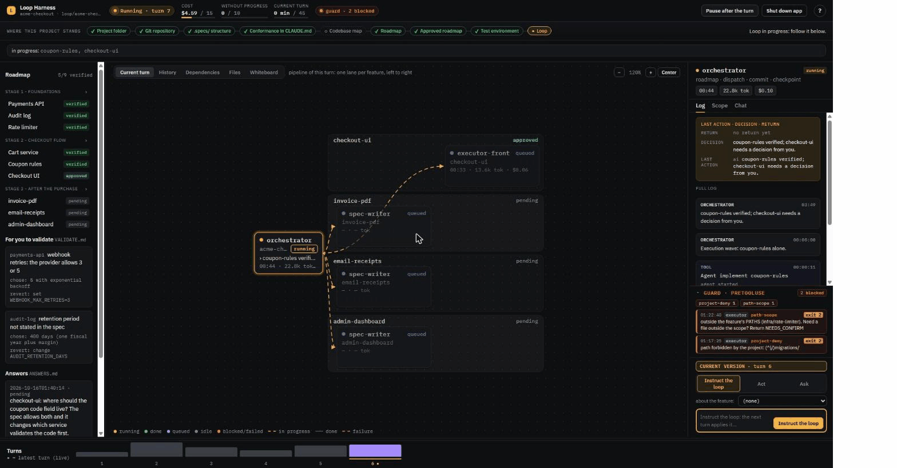
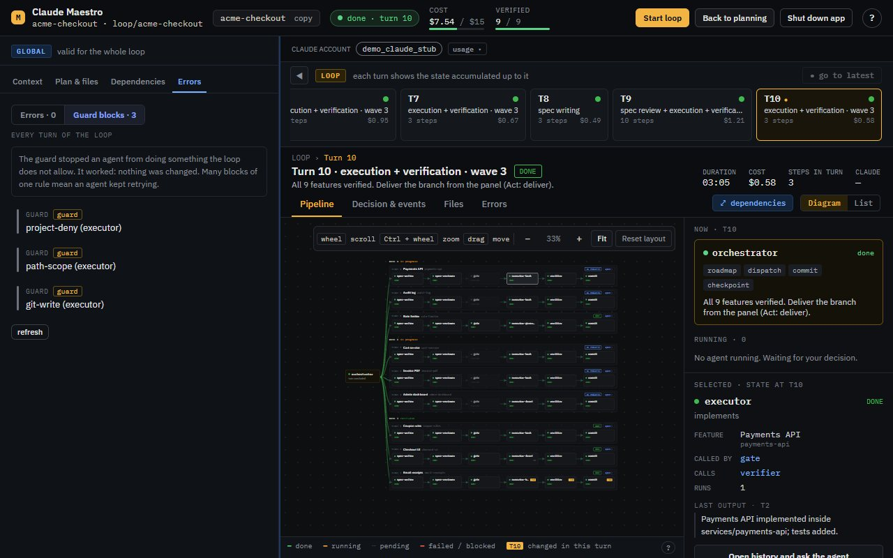
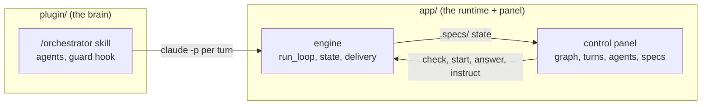

# Loop Harness

**A local control panel and a plugin that drive your own `claude` subscription through a planned, guarded loop.** You plan by chat, approve a roadmap with a click, and the loop builds it in waves of parallel features while a guard hook holds every agent inside its scope. It runs 100% on your machine and installs zero Python packages.



> Try it without wiring a real repo: `python app/harness.py demo` animates a whole loop on a throwaway project with mocked data. It never starts `claude`.

## The problem

Running autonomous coding agents through the API gets expensive fast. Running them with `claude -p` in a bash loop uses your subscription instead, but it leaves you blind in a sea of Markdown files, and nothing stops an agent from editing files outside its scope or from loading every skill, plugin and MCP server your profile happens to have.

## What it does

Loop Harness separates the **brain** (skills, agents and the guard, the `plugin/`) from the **runtime** (a deterministic Python engine plus a web panel, the `app/`).

1. **Plan by chat.** A new project opens in planning mode. A live chat (`/orchestrator plan`) asks you questions and writes `PROJECT.md`, `ROADMAP.md` and `FLOWS.md` (the flow that proves each feature) while you watch them in a preview. The chat answers right away: the safety snapshot and prompt build run in the job thread, and the user message is saved before the request answers (measured: a send went from about 2.2 to 2.8 s to 17 to 66 ms server side, and the message shows in the browser in 2 to 12 ms; [`app/docs/ARCHITECTURE.md`](app/docs/ARCHITECTURE.md), "Instant chat").
2. **Or import a spec you already have.** Point the panel at a tlc-spec-driven feature folder: it is copied (read only, credentials redacted), the planning chat builds ROADMAP, FLOWS and PROJECT from it, and an **import coverage gate** fails until every requirement, decision and task id of the source has a row in `IMPORT-COVERAGE.md` (a destination, or `dropped: <reason>`). Nothing of the source is lost silently ([`app/docs/API.md`](app/docs/API.md), "Planning: import a spec and readiness").
3. **Approve the roadmap.** **Approve roadmap** unlocks only when the checklist is green: prerequisites, a goal, valid features, no open question and a flow per feature. The loop does not start without an approved roadmap, and only your click approves it.
4. **Run the loop.** Features are nodes with dependency edges. Each turn the engine picks a wave of features whose paths do not overlap and whose dependencies are done, and the orchestrator fans them out to parallel Sonnet subagents (spec, gate, execute, verify, commit). The loop works in its own worktree and branch, never yours.
5. **Wrap up and deliver.** At the end you review the decisions the loop took for you, **Finish** pushes only the feature branch and opens the PR (`harness.py deliver`), and an optional **follow-up** stage turns what you found into new features.

The engine, not the model, owns the state: Python validates every transition, chooses the next wave, snapshots each turn so you can `--rewind`, and refuses an unapproved roadmap.

## The guard

A `PreToolUse` hook (`plugin/skills/orchestrator/hooks/guard.py`) runs on the orchestrator, on every subagent and on the app's own `claude -p` jobs. It blocks with exit 2; each rule ships with tests that run against the real hook, and you watch the blocks live in the panel.

- **Profiles.** `orchestrator`, `executor`, `spec`, `verifier` for the loop; `planning`, `roadmapmap`, `subprojects`, `systemmap` for the app's jobs. Each profile gets only the rules it needs ([`plugin/skills/orchestrator/hooks/README.md`](plugin/skills/orchestrator/hooks/README.md)).
- **Scope per task.** An executor may edit only the paths of its feature (`SCOPE.json`) and, when dispatched per task (`SCOPE_TASK: <slug>/<Tn>`), only the files of that task.
- **No push except deliver.** Every `git push` and `gh` command is blocked inside the loop (`headless-push`, `headless-gh`); a push to the integration branch, `main` or a force push is blocked for any caller. Delivery belongs to the engine.
- **PROD is read only.** A writing SQL statement through a production MCP tool is denied and no `PERMISSIONS.json` entry releases it (`prod-sql-write`); the production MCP tool is allowed only to the orchestrator and planning profiles.
- **MCP and skill allowlists.** In the loop and in app jobs, any `mcp__*` tool outside the profile's list is denied (`mcp-allowlist`), and a `Skill` call outside the profile's list is denied (`skill-allowlist`). Allowed MCP and Skill calls are written to `guard.log` as `allow` lines for audit. Your interactive sessions are never limited by these two rules ([`app/docs/MONITOR.md`](app/docs/MONITOR.md), "Guard and access").
- **Runtime isolation.** Every `claude -p` the app starts runs with `--setting-sources project,local` plus a bundle that holds only the 8 plugin agents and the allowlisted skills (18 names with the defaults, found in your `~/.claude/skills`, the dev toolkit or the Maestro plugin, plus the skills your projects bind to their standards slots). Your other user plugins, your other skills, your hooks and plugin MCP servers do not load. A real `init` probe under isolation showed no MCP server outside the app's generated config, only the bundle agents and skills plus Claude Code built-ins, and `/orchestrator` available; a real headless call had the guard deny a non-allowlisted skill (`[skill-allowlist]`). Kill switch: `"loop_isolation": false` in `~/.loop-harness/config.json` ([`app/docs/ARCHITECTURE.md`](app/docs/ARCHITECTURE.md), "Runtime isolation").
- **See it, do not trust it.** `python app/harness.py doctor --access` prints, per profile, the MCP tools and skills allowed, the bundle contents, a probe of what the isolated `claude` really loads (flagging anything outside the allowlists) and a summary of the last 200 `guard.log` lines. It is read only ([`app/docs/HOW_TO_USE.md`](app/docs/HOW_TO_USE.md), "Isolation and access").



Two honest notes:

- **Headless runs count toward your plan's usage limits.** Each turn is a `claude -p` call, the same as any other Claude Code use. When the account hits a limit, the loop waits and retries (`--limit-wait`, `--limit-retries`) and then stops with a notice. If your CLI is signed in with an API key instead of a plan, that key is billed.
- **The CLI's JSON contract is covered by tests.** The engine reads `claude -p --output-format stream-json --verbose` through one tolerant parser: the last `result` event, plus the `rate_limit_event` that carries the account's 5-hour and weekly usage. `app/backend/tests/engine/test_cli_contract.py` replays recorded output shapes on every test run: errors, budget stops, arrays, stream-json, warning lines, missing or renamed fields, garbage. An opt-in live test (`LOOP_LIVE_CLI_TEST=1`) runs one tiny real prompt against your installed CLI. Output the parser cannot read stops the loop with an `unrecognized_output` error; it is never counted as a turn. `harness.py doctor` shows your `claude --version` next to the version the contract was last tested with.



## Why a panel

A loop that runs for hours writes dozens of files: `ROADMAP.md`, `FLOWS.md`, `STATE.md`, `VALIDATE.md`, `ANSWERS.md`, `LOOP.json`, a spec per feature, turn logs, snapshots and the transcript of every subagent. Reading them one `.md` at a time does not show you what is happening.

The panel puts them in one view, and turns the engine commands into buttons that ask for confirmation. The commands are `--check`, `--answer`, `--option`, `--rewind`, the state checks and the final delivery. There is less to type and nothing to paste wrong.

- **Graph engineering.** The roadmap is a graph: features grouped by stage, with dependency edges and status colours. The state machine shows how many features are in each node. Click a node to open that feature, turn or agent and act on that point: read its spec, inspect its log, chat about it, send an instruction, or answer its question.
- **Loop engineering.** Watch the current turn by lane, the history of every agent with tokens and duration, the limits (cost, turns without progress), and the quarantine. The panel also lists the decisions the loop took for you to validate later.
- **Any starting point.** Create a project from scratch (folder, git, `.specs/`), open an existing repo (map it, then plan the roadmap in the planning chat), or open a project whose loop stopped midway: the panel shows where it is and the next action.
- **Local and lean.** Python standard library only (**zero `pip install`**), ES modules served as-is (**no `npm`, no build step**), listening on `127.0.0.1` only, with your own plan through the `claude` CLI: no API key to manage and no hosted service.

## Layout

| Folder | What it is |
|---|---|
| `plugin/` | The Claude Code plugin: `/orchestrator` skill and its satellites, `repo-catalog`, 8 Sonnet-capped subagents and the `PreToolUse` guard hook. It ships no dev skills: those come from the dev toolkit below. |
| `app/` | Loop Harness: the loop engine (`run_loop`, state, delivery, notifications), a layered Python API and the web panel. Standard library only, no `pip`, no `npm`: `python app/harness.py serve` starts the back end and the front end together. |

### Companion plugin: Claude Dev Toolkit

The dev skills the agents follow live in their own plugin, [**claude-dev-toolkit**](https://github.com/iagopadilha/claude-dev-toolkit): `backend-dev`, `frontend-dev`, `github`, `tlc-spec-driven` (the spec engine), `flow-validator` and the Playwright skills, plus the shared scripts they use (`verify.py`, `testenv.py`, `regression_diff.py`...). They are generic. A team's own rules (Git flow, design system, app map, logs) plug in through the **standards slots** that each project declares in a `## Standards` section of its `CLAUDE.md`, next to the `Conformance` block. The toolkit's README and `docs/STANDARDS.md` have the slot contract.

- **Maestro requires the toolkit.** Executors, the spec writer and the verifiers load its skills, and every dispatch carries a `TOOLKIT: <path>` line so they find its scripts. The toolkit does not depend on Maestro. `harness.py doctor` FAILs when the toolkit is not found and `harness.py paths` prints where it is.
- **In the isolated loop** the bundle and the per-profile skill allowlist take the toolkit skills plus the skills bound to the project's slots.
- **Standards from the terminal or the panel.** `python app/harness.py standards <repo>` shows and edits the bindings; the **Standards** block of the panel's installer card does the same.

## Install

Requires Python 3.10+, Git and Claude Code signed in with your subscription. `gh` is needed only for the final PR.

1. Clone the repo and run the setup:
   ```
   git clone https://github.com/iagopadilha/loop-engineering-harness
   cd loop-engineering-harness
   python install.py
   ```
   `install.py` does these steps, printing one PASS, WARN or FAIL line per step:
   - checks Python, `git`, `claude` (and that `claude --version` answers) and the optional `gh`;
   - creates `~/.loop-harness/` and copies `app/.env.example` to `~/.loop-harness/.env`, only if that file is missing;
   - registers the app so the skill can find it (`harness.py install`);
   - looks for the claude-dev-toolkit plugin and warns when it is not found (you install it in the next step);
   - runs `harness.py doctor`, which checks the skill, the guard, the toolkit, the `claude` CLI and its version, and your notification channels.

   It exits non-zero on a hard failure, and `--yes` skips its one prompt. It installs nothing system-wide and never asks for a token.
2. Install the two plugins in Claude Code: Maestro and the dev toolkit it requires (`install.py` prints these too, and warns while the toolkit is missing):
   ```
   /plugin marketplace add iagopadilha/loop-engineering-harness
   /plugin install loop-engineering-harness@loop-engineering-harness
   /plugin marketplace add iagopadilha/claude-dev-toolkit
   /plugin install claude-dev-toolkit@claude-dev-toolkit
   ```

To do the same by hand, run `python app/harness.py install` and then `python app/harness.py doctor`. For a toolkit kept outside the plugin cache, set `dev_toolkit_dir` in `~/.loop-harness/config.json`; a sibling clone at `../claude-dev-toolkit` is found by itself.

## Use

Open the panel (back end + front end, opens your browser):

```
python app/harness.py serve                      # hub: your projects, create or open a folder
python app/harness.py serve --project <repo>     # straight to one project
python app/harness.py demo                       # a fake project with moving loop data; no claude, nothing of yours touched
python app/harness.py doctor --access            # what a claude -p of the app can reach: MCP, skills, bundle, probe, guard.log
```

`demo` creates a throwaway project (`acme-checkout`) in a temporary folder and animates a whole loop in about 2 minutes:
waves of features, agent logs, a guard block and a question. `--speed 2` halves it and `--loop` repeats it for a recording.

Or start from a chat. The skill opens the panel for you when it writes the roadmap:

```
/orchestrator map        document an unfamiliar repo
/orchestrator plan       plan by conversation: it asks, you answer, it writes PROJECT, ROADMAP and FLOWS
/orchestrator roadmap    propose the roadmap (and its flows) in one go; approve it in the panel
/orchestrator stage 1    run one stage (or /orchestrator <slug> for one feature)
```

Run the loop unattended from the panel with **Check** and then **Start loop**, or from a terminal:

```
python app/harness.py check <repo>               # creates and spends nothing; prints READY or what is missing
python app/harness.py loop <repo> --wave 2       # the command check printed
```

Each turn is a fresh `claude -p` with a clean context. The loop works in its own worktree and branch, never yours. It stops when it is done, when it needs you (answer in the panel or with `--answer`) or on an error. Step by step: [`app/docs/HOW_TO_USE.md`](app/docs/HOW_TO_USE.md).

### Notifications

Every end of the loop notifies you: success, error, a question, a quarantine pause. The `console`, `toast` and `file` channels work out of the box. The `email` (SMTP) and `webhook` (JSON POST) channels need a provider **you** set up. `install.py` copies `app/.env.example` to `~/.loop-harness/.env` (copy it yourself if you skipped the script). Fill in the `LOOP_*` variables and never commit the file. Test it with `python app/harness.py notify --test`. Every notice carries the panel link.

## Customize

Everything is plain Markdown and Python:

- **Per project:** rules in `.specs/project/RULES.md` (the `orchestrator-create-block-rule` skill writes and tests them), your exceptions in `.specs/project/loop/json/PERMISSIONS.json`, and `Conformance:` in `CLAUDE.md`.
- **Your team's standards:** bind the toolkit's slots (`git`, `backend`, `frontend`, `app-map`, `observability`) to your company's skills in the `## Standards` section of each repo's `CLAUDE.md` (in a monorepo, of each subproject's, never the root one), with `harness.py standards` or the panel's installer card. Maestro never names a company skill itself: a bound skill joins the loop's allowlists and bundle by itself.
- **Behaviour:**
  - agent prompts in `plugin/agents/`;
  - phases in `plugin/skills/orchestrator/SKILL.md`;
  - the dev skills themselves, in the [claude-dev-toolkit](https://github.com/iagopadilha/claude-dev-toolkit) repository;
  - guard profiles in `plugin/skills/orchestrator/hooks/guard.py`;
  - engine in `app/backend/harness_backend/engine/`.
- **Settings:** the `LOOP_*` and `GUARD_PROD_HINTS` variables (see `app/.env.example`), and the **Settings** button of the hub and the panel (isolation, caveman mode, extra skills, model, limits: saved in `~/.loop-harness/config.json`).

## Guard rules

The guard is a `PreToolUse` hook on the orchestrator, its subagents and the app's jobs. It blocks push to protected branches, force push, credential reads, installs, writes to loop state and more. You can add your own project rules on top. This rule in `.specs/project/loop/json/PERMISSIONS.json` blocks `terraform apply` and `terraform destroy` for the orchestrator and every subagent, and lets `terraform plan` through:

```json
{"deny_bash_regex": ["\\bterraform\\s+(?:-\\S+\\s+)*(?:apply|destroy)\\b"]}
```

[`plugin/skills/orchestrator/hooks/README.md`](plugin/skills/orchestrator/hooks/README.md) has the rest:

- the built-in rules and which of them are hard (`PERMISSIONS.json` cannot lift them);
- the profiles and the fail-open behaviour;
- a cookbook: destructive SQL, never on `main`, `migrations/` and `infra/prod/`, `terraform`/`kubectl`;
- the `rules propose|write|test` flow.

Every cookbook example is proven by `test_guard_cookbook.py`.

## Guarantees

- No subagent runs above Sonnet, even after a failure.
- Only the orchestrator runs git. Only the feature branch is pushed, and only at the end. The integration branch (`LOOP_INTEGRATION_BRANCH`, default `developer`), `main` and force pushes are blocked.
- Every `claude -p` the app starts runs isolated from your profile (`--setting-sources project,local` and a bundle of 8 agents and the allowlisted skills, the project's slot skills included); the guard allows only the MCP tools and skills of each profile, and production SQL is read only. `harness.py doctor --access` shows it.
- The panel listens only on `127.0.0.1`, checks the `Host` header and requires a per-run token on every write. Its chat is read-only (no tools that write, no MCP). Starting a loop, approving a roadmap and delivering always take your click.
- The guard acts only on this plugin's subagents, the orchestrator skill and the app's own `claude -p` jobs. The MCP and skill allowlists apply only there (`LOOP_HEADLESS=1` or `LOOP_ISOLATED=1`); your interactive sessions are unaffected.
- Maestro names no company. Company skills enter only through the `## Standards` section of your projects, and the user-level shared `.env` of the credential layers is read only when you set `user_shared_dir`.

## Tests

From the repository root:

```
python -m unittest discover -s app/backend/tests -t app/backend                      # engine, API, CLI contract, install.py, standards
python -m unittest discover -s plugin/skills/orchestrator/hooks -p "test_guard*.py"  # guard + cookbook
```

The tests are hermetic: `app/backend/tests/__init__.py` points `LOOP_CLAUDE_HOME`, the user-level shared folder and the MCP config at temporary locations and hides the sibling toolkit clone (`../claude-dev-toolkit`), and tests that need a toolkit name a fake one through `dev_toolkit_dir`, so your `~/.claude` and your clone are never read. Only the credential parity test opts in to the real toolkit and skips without it.

The live CLI contract test is skipped by default. It sends one tiny real prompt (`--max-budget-usd 0.05`) through your signed-in `claude`, so it counts toward your plan's usage:

```
LOOP_LIVE_CLI_TEST=1 python -m unittest discover -s app/backend/tests -t app/backend -p test_cli_contract.py
```

## License

MIT, see `LICENSE`. The third-party credits for `tlc-spec-driven` (Tech Lead's Club, CC-BY-4.0) and `playwright-cli` (microsoft/playwright-cli, Apache-2.0) belong to [claude-dev-toolkit](https://github.com/iagopadilha/claude-dev-toolkit), which ships those skills; Maestro ships neither.
