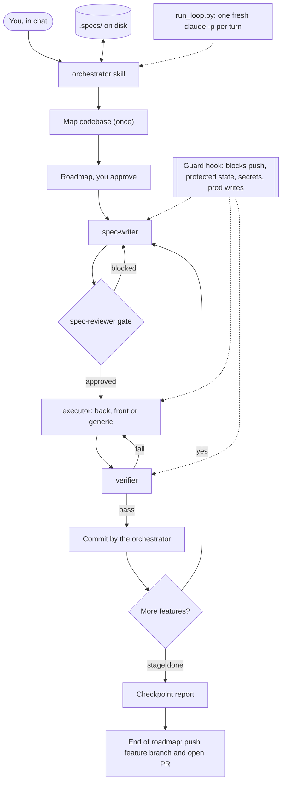

# loop-engineering-harness

A Claude Code plugin that turns one chat into an **orchestrator**. It plans a roadmap, has subagents write and review specs, implement and verify each feature, and keeps all state on disk. A Python script can run the same loop unattended.



## Install

Requires Python 3 and Git on `PATH`. `gh` is needed only for the final PR. The `flow-validator` skill expects the `playwright-cli` skill for browser tests (optional).

```
/plugin marketplace add iagopadilha/loop-engineering-harness
/plugin install loop-engineering-harness@loop-engineering-harness
```

To try it from a local clone instead: `claude --plugin-dir ./loop-engineering-harness`.

## Use

```
/orchestrator map          document an unfamiliar repo (no code touched)
/orchestrator roadmap      propose the roadmap, you approve it
/orchestrator stage 1      run one stage, or /orchestrator <slug> for one feature
```

The first time, it asks for `Conformance: STANDARD` (new code follows the standard) or `LEGACY` (minimal edits in the project's own style) and saves it in the project's `CLAUDE.md`. Say `autopilot` to skip the stage checkpoints.

## Unattended loop

Run it in a separate terminal. Check first, which creates and spends nothing:

```
python <plugin>/skills/orchestrator/loop/run_loop.py <project> --check
```

It prints `READY` with the exact command, or lists the problems. Useful flags: `--wave N` (parallel features), `--e2e`, `--no-push`, `--max-cost N`, `--answer "..."` to resume after a question, `--rewind N --yes` to go back. The loop works in its own worktree and never touches your branch. Details: `skills/orchestrator/loop/HOW_TO_USE.md`.

Notifications (console, toast, file, email, webhook) are configured with `LOOP_*` variables. Copy `shared/.env.example` to a file **outside the plugin folder** (updates replace it) and point `LOOP_ENV_FILE` to it. Never commit it.

## Guarantees

- No subagent runs above Sonnet, even after a failure.
- Only the orchestrator runs git. Only the feature branch is pushed, only at the end. The integration branch (default `developer`, set `LOOP_INTEGRATION_BRANCH`), `main` and force pushes are blocked.
- The guard acts only on this plugin's subagents and the orchestrator skill. Your other Claude Code work is not affected.

## What is inside

`orchestrator` plus three satellites (block rules, dependency audit, progress graph) · `tlc-spec-driven` · `flow-validator` · `backend-dev` and `frontend-dev` best-practice skills · 8 subagents · the guard hook · the loop script and its tests.

## License

MIT, see `LICENSE`. `skills/tlc-spec-driven` is based on work by [Felipe Rodrigues](https://github.com/felipfr) of the [Tech Lead's Club](https://github.com/tech-leads-club), licensed [CC-BY-4.0](https://creativecommons.org/licenses/by/4.0/) and modified here (translated and adapted to the orchestrator). The original author and license are kept in that skill.
