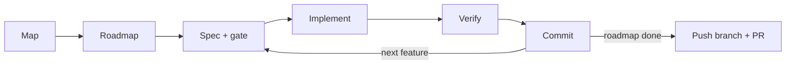

# loop-engineering-harness

A Claude Code plugin that turns one chat into an **orchestrator**: it plans a roadmap, has subagents write, review, implement and verify each feature, and keeps all state on disk. A Python script can run the same loop unattended.



A guard hook blocks risky actions for the subagents, and `.specs/` holds the state, so any turn can resume.

## Install

Requires Python 3 and Git. `gh` is needed only for the final PR.

```
/plugin marketplace add iagopadilha/loop-engineering-harness
/plugin install loop-engineering-harness@loop-engineering-harness
```

From a local clone instead: `claude --plugin-dir ./loop-engineering-harness`.

## Use

```
/orchestrator map        document an unfamiliar repo
/orchestrator roadmap    propose the roadmap; you approve it
/orchestrator stage 1    run one stage (or /orchestrator <slug> for one feature)
```

On first use it asks for `Conformance: STANDARD` (new code follows the standard) or `LEGACY` (minimal edits in the project's own style) and saves it in the project's `CLAUDE.md`.

## Run the unattended loop

1. Work in a normal conversation until the roadmap is approved.
2. **After you approve, the orchestrator prints the ready command**, with the plugin path already filled in.
3. Run that command in a separate terminal, outside Claude.

```
python <plugin>/skills/orchestrator/loop/run_loop.py <project> --check
```

`<plugin>` is the folder where Claude installed the plugin on **your** machine (typically under `~/.claude/plugins/cache/`). If you type the command by hand, replace it with that path. `--check` creates and spends nothing: it prints `READY` with the final command, or lists what is missing. The loop uses its own worktree and never touches your branch. Flags: `skills/orchestrator/loop/HOW_TO_USE.md`.

**Want to see a whole run, step by step?** Read the [complete example flow](skills/orchestrator/references/example-flow.md): from the first chat to the merged PR, with the files, statuses, a failure, a question and the notifications.

### Notifications

Every end of the loop notifies you: success, error, a question for you, a quarantine pause. Channels: `console`, `toast` (OS notification) and `file` work out of the box; `email` (SMTP) and `webhook` (a JSON POST) need a provider **you** set up. The plugin ships no account: get SMTP credentials from your mail provider, or a webhook URL from your chat or automation tool.

Copy `shared/.env.example` to a file **outside the plugin folder** (updates replace that folder), fill in the `LOOP_*` variables, point `LOOP_ENV_FILE` to it, and never commit it. Test it with `python <plugin>/skills/orchestrator/loop/notify.py --test`. When the loop stops for a question, the notice carries a ready command per option, so you answer with one line. Another provider is one function in `loop/notify.py`.

## Customize

Everything is plain Markdown and Python, so change what you need:

- **Per project:** rules in `.specs/project/RULES.md` (the `orchestrator-create-block-rule` skill writes and tests them), your exceptions in `PERMISSIONS.json`, and `Conformance:` in `CLAUDE.md`.
- **Behaviour:** the agent prompts in `agents/`, the phases in `skills/orchestrator/SKILL.md`, the guard profiles in `skills/orchestrator/hooks/guard.py`, the shared best-practice text in `shared/CORE_DEV.md`.
- **Settings:** `LOOP_*` and `GUARD_PROD_HINTS` variables (see `shared/.env.example`).

Edits made inside the installed plugin folder are replaced on update. To keep yours, fork this repo and install from your fork.

## Guarantees

- No subagent runs above Sonnet, even after a failure.
- Only the orchestrator runs git. Only the feature branch is pushed, only at the end. The integration branch (default `developer`, set by `LOOP_INTEGRATION_BRANCH`), `main` and force pushes are blocked.
- The guard acts only on this plugin's subagents and the orchestrator skill. Your other work is unaffected.

## What is inside

- `orchestrator` plus three satellites: block rules, dependency audit, progress graph.
- `tlc-spec-driven`: the spec engine the orchestrator drives.
- `flow-validator` and `playwright-cli`: end-to-end checks with curl and a browser.
- `backend-dev` and `frontend-dev`: best-practice skills built on `shared/CORE_DEV.md` (SOLID, smell to technique to pattern, regression proof). If a `refactoring-guru-techniques` skill is installed, they load it for the full catalog.
- 8 subagents, the guard hook, the loop script and its tests.

## License

MIT, see `LICENSE`. Third-party:

- `skills/tlc-spec-driven`: based on work by [Felipe Rodrigues](https://github.com/felipfr) of the [Tech Lead's Club](https://github.com/tech-leads-club), CC-BY-4.0, modified here.
- `skills/playwright-cli`: from [microsoft/playwright-cli](https://github.com/microsoft/playwright-cli), Apache-2.0, modified here. Its license is in that folder.
