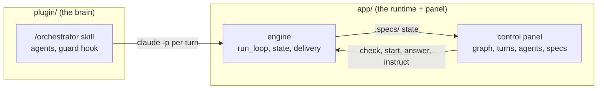

# loop-engineering-harness

A harness for **loop engineering** with Claude Code. It does two things:

- **plans and runs the loop:** one chat becomes an orchestrator that maps the repo, plans a roadmap, and has subagents spec, review, implement and verify each feature, with all state on disk;
- **shows you the whole loop:** a local control panel lets you see and steer it. You get the roadmap as a graph of nodes, the turns, the agents, the specs, the open questions, and the cost.

It runs **locally** and drives everything through the `claude` CLI, so it uses **your own Claude subscription**. There is no API key, token or hosted service to set up.

## Why it exists

It is a visual orchestrator for software agents that runs on your machine. It keeps the whole loop state on disk, which lets a development loop run for hours across many features, stop, and resume where it left off. It drives Claude through the `claude` CLI you are already signed in to. The work runs on your own Claude plan, not on per-token API billing.

Two honest notes:

- **Headless runs count toward your plan's usage limits.** Each turn is a `claude -p` call, the same as any other Claude Code use. When the account hits a limit, the loop waits and retries (`--limit-wait`, `--limit-retries`) and then stops with a notice. If your CLI is signed in with an API key instead of a plan, that key is billed.
- **The CLI's JSON contract is covered by tests.** The engine reads `claude -p --output-format json` through one tolerant parser. `app/backend/tests/engine/test_cli_contract.py` replays recorded output shapes on every test run: errors, budget stops, arrays, stream-json, warning lines, missing or renamed fields, garbage. An opt-in live test (`LOOP_LIVE_CLI_TEST=1`) runs one tiny real prompt against your installed CLI. Output the parser cannot read stops the loop with an `unrecognized_output` error; it is never counted as a turn. `harness.py doctor` shows your `claude --version` next to the version the contract was last tested with.



## Why a panel

A loop that runs for hours writes dozens of files: `ROADMAP.md`, `STATE.md`, `VALIDATE.md`, `ANSWERS.md`, `LOOP.json`, a spec per feature, turn logs, snapshots and the transcript of every subagent. Reading them one `.md` at a time does not show you what is happening.

The panel puts them in one view, and turns the engine commands into buttons that ask for confirmation. The commands are `--check`, `--answer`, `--option`, `--rewind`, the state checks and the final delivery. There is less to type and nothing to paste wrong.

- **Graph engineering.** The roadmap is a graph: features grouped by stage, with dependency edges and status colours. The state machine shows how many features are in each node. Click a node to open that feature, turn or agent and act on that point: read its spec, inspect its log, chat about it, send an instruction, or answer its question.
- **Loop engineering.** Watch the current turn by lane, the history of every agent with tokens and duration, the limits (cost, turns without progress), and the quarantine. The panel also lists the decisions the loop took for you to validate later.
- **Any starting point.** Create a project from scratch (folder, git, `.specs/`), open an existing repo (map it, then generate the roadmap), or open a project whose loop stopped midway: the panel shows where it is and the next action.
- **The roadmap gate stays yours.** Generate the roadmap from a goal inside the panel, refine it, and approve it with a click. The loop does not start without an approved roadmap.

## Layout

| Folder | What it is |
|---|---|
| `plugin/` | The Claude Code plugin: `/orchestrator` skill and its satellites, 8 Sonnet-capped subagents, the `PreToolUse` guard hook, the spec engine, flow validation and dev best-practice skills. |
| `app/` | Loop Harness: the loop engine (`run_loop`, state, delivery, notifications), a layered Python API and the web panel. Standard library only, no `pip`, no `npm`: `python app/harness.py serve` starts the back end and the front end together. |

## Install

Requires Python 3.10+, Git and Claude Code signed in with your subscription. `gh` is needed only for the final PR.

1. Clone the repo and run the setup:
   ```
   git clone https://github.com/iagopadilha/loop-engineering-harness
   cd loop-engineering-harness
   python install.py
   ```
   `install.py` does these steps, printing one PASS, WARN or FAIL line per step:
   - checks Python, `git`, `claude` (and that `claude --version` answers) and the optional `gh`;
   - creates `~/.loop-harness/` and copies `app/.env.example` to `~/.loop-harness/.env`, only if that file is missing;
   - registers the app so the skill can find it (`harness.py install`);
   - runs `harness.py doctor`, which checks the skill, the guard, the `claude` CLI and its version, and your notification channels.

   It exits non-zero on a hard failure, and `--yes` skips its one prompt. It installs nothing system-wide and never asks for a token.
2. Install the plugin in Claude Code (`install.py` prints these too):
   ```
   /plugin marketplace add iagopadilha/loop-engineering-harness
   /plugin install loop-engineering-harness@loop-engineering-harness
   ```

To do the same by hand, run `python app/harness.py install` and then `python app/harness.py doctor`.

## Use

Open the panel (back end + front end, opens your browser):

```
python app/harness.py serve                      # hub: your projects, create or open a folder
python app/harness.py serve --project <repo>     # straight to one project
```

Or start from a chat. The skill opens the panel for you when it writes the roadmap:

```
/orchestrator map        document an unfamiliar repo
/orchestrator roadmap    propose the roadmap; approve it in the panel
/orchestrator stage 1    run one stage (or /orchestrator <slug> for one feature)
```

Run the loop unattended from the panel with **Check** and then **Start loop**, or from a terminal:

```
python app/harness.py check <repo>               # creates and spends nothing; prints READY or what is missing
python app/harness.py loop <repo> --wave 2       # the command check printed
```

Each turn is a fresh `claude -p` with a clean context. The loop works in its own worktree and branch, never yours. It stops when it is done, when it needs you (answer in the panel or with `--answer`) or on an error. Step by step: [`app/docs/HOW_TO_USE.md`](app/docs/HOW_TO_USE.md).

### Notifications

Every end of the loop notifies you: success, error, a question, a quarantine pause. The `console`, `toast` and `file` channels work out of the box. The `email` (SMTP) and `webhook` (JSON POST) channels need a provider **you** set up. `install.py` copies `app/.env.example` to `~/.loop-harness/.env` (copy it yourself if you skipped the script). Fill in the `LOOP_*` variables and never commit the file. Test it with `python app/harness.py notify --test`. Every notice carries the panel link.

## Customize

Everything is plain Markdown and Python:

- **Per project:** rules in `.specs/project/RULES.md` (the `orchestrator-create-block-rule` skill writes and tests them), your exceptions in `.specs/project/loop/json/PERMISSIONS.json`, and `Conformance:` in `CLAUDE.md`.
- **Behaviour:**
  - agent prompts in `plugin/agents/`;
  - phases in `plugin/skills/orchestrator/SKILL.md`;
  - guard profiles in `plugin/skills/orchestrator/hooks/guard.py`;
  - engine in `app/backend/harness_backend/engine/`.
- **Settings:** the `LOOP_*` and `GUARD_PROD_HINTS` variables (see `app/.env.example`).

## Guard rules

The guard is a `PreToolUse` hook on the orchestrator and its subagents. It blocks push to protected branches, force push, credential reads, installs, writes to loop state and more. You can add your own project rules on top. This rule in `.specs/project/loop/json/PERMISSIONS.json` blocks `terraform apply` and `terraform destroy` for the orchestrator and every subagent, and lets `terraform plan` through:

```json
{"deny_bash_regex": ["\\bterraform\\s+(?:-\\S+\\s+)*(?:apply|destroy)\\b"]}
```

[`plugin/skills/orchestrator/hooks/README.md`](plugin/skills/orchestrator/hooks/README.md) has the rest:

- the built-in rules and which of them are hard (`PERMISSIONS.json` cannot lift them);
- the profiles and the fail-open behaviour;
- a cookbook: destructive SQL, never on `main`, `migrations/` and `infra/prod/`, `terraform`/`kubectl`;
- the `rules propose|write|test` flow.

Every cookbook example is proven by `test_guard_cookbook.py`.

## Guarantees

- No subagent runs above Sonnet, even after a failure.
- Only the orchestrator runs git. Only the feature branch is pushed, and only at the end. The integration branch (`LOOP_INTEGRATION_BRANCH`, default `developer`), `main` and force pushes are blocked.
- The panel listens only on `127.0.0.1`, checks the `Host` header and requires a per-run token on every write. Its chat is read-only (no tools that write, no MCP). Starting a loop, approving a roadmap and delivering always take your click.
- The guard acts only on this plugin's subagents and the orchestrator skill. Your other work is unaffected.

## Tests

From the repository root:

```
python -m unittest discover -s app/backend/tests -t app/backend                      # engine, API, CLI contract, install.py
python -m unittest discover -s plugin/skills/orchestrator/hooks -p "test_guard*.py"  # guard + cookbook
```

The live CLI contract test is skipped by default. It sends one tiny real prompt (`--max-budget-usd 0.05`) through your signed-in `claude`, so it counts toward your plan's usage:

```
LOOP_LIVE_CLI_TEST=1 python -m unittest discover -s app/backend/tests -t app/backend -p test_cli_contract.py
```

## License

MIT, see `LICENSE`. Third-party:

- `plugin/skills/tlc-spec-driven`: based on work by [Felipe Rodrigues](https://github.com/felipfr) of the [Tech Lead's Club](https://github.com/tech-leads-club), CC-BY-4.0, modified here.
- `plugin/skills/playwright-cli`: from [microsoft/playwright-cli](https://github.com/microsoft/playwright-cli), Apache-2.0, modified here. Its license is in that folder.
